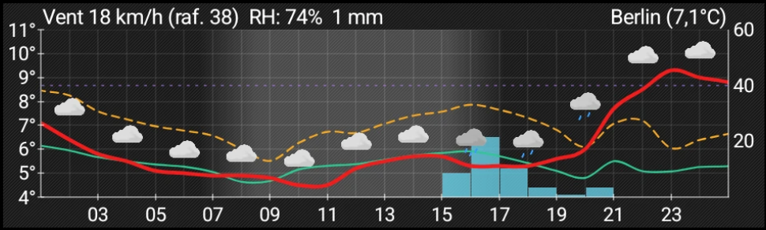

# AF Wind Widget

Personal fork of [AF Weather Widget](https://github.com/Gitsaibot/AF-Weather-Widget): the same compact graphical weather widget for Android, with **mean wind and gusts** (km/h) and forecasts from the **Météo-France models** (AROME, then ARPEGE) through [Open-Meteo](https://open-meteo.com/).

## Changes from the original

- **Weather source**: Open-Meteo with the Météo-France models (`meteofrance_seamless`) — free, no account or key. MET Norway is still available in the settings. The US-only NOAA source was removed.
- **Wind**: each hour, a dot for the mean wind and a dot for the strongest gust, linked by a line and aligned with the rain bars, with a km/h scale on the right side of the graph.
- **Strong wind threshold**: above the threshold (40 km/h by default) the dots and lines change color, and a dotted line marks the threshold.
- **Top line**: the current wind ("Wind 18 km/h (gust 38)") replaces the sea level pressure (MSLP).
- **New settings** (Appearance → Wind): show wind, threshold, mean wind color, gust color and above-threshold color.
- **Location search and time zones**: Open-Meteo instead of GeoNames (no GeoNames account needed).
- **Feels-like temperature and cloud cover**: a shaded area between the real and feels-like temperature, and a grey veil from the top of the graph that reaches lower when it is cloudier (Appearance → Feels-like and clouds).
- **Weather icons**: the original color icons, or the monochrome [Meteocons](https://github.com/basmilius/meteocons) or [Material Symbols](https://github.com/google/material-design-icons) sets in a color of your choice, or the color Meteocons Flat and Line sets (Appearance → Weather icons).
- **Backup and restore**: save the settings and locations to a file (Downloads, Google Drive...) and load them back, from the main settings screen.
- **Smaller APK**: unused library code and resources are removed at build time.
- The app is called "AF Wind" (`net.auborddulit.afwind`) and can be installed next to the original.

## Install on the phone

Every change makes GitHub build a new APK automatically (after the unit tests pass). Open the [Releases](https://github.com/auborddulit/AF-Wind-Widget/releases) page on the phone, download the `.apk` of the latest version and open it. New versions install over the previous one and keep the settings. Only the 5 latest versions are kept.

## Acknowledgements and licences

- Original code: [AF Weather Widget](https://github.com/Gitsaibot/AF-Weather-Widget) by Gitsaibot, itself derived from aix weather widget — [CC0](https://creativecommons.org/publicdomain/zero/1.0/) (except `MultiKey.java` and `Pair.java`, Apache 2.0).
- Weather data: [Open-Meteo](https://open-meteo.com/) ([CC BY 4.0](https://creativecommons.org/licenses/by/4.0/)), based on the models of [Météo-France](https://meteofrance.com/).
- Sun and moon rise/set: [Norwegian Meteorological Institute (MET Norway)](https://api.met.no/).
- Weather icons: owned by MET Norway, via their [weathericon API](https://api.met.no/weatherapi/weathericon/2.0/documentation).
- Extra weather icons: [Meteocons](https://github.com/basmilius/meteocons) by Bas Milius (MIT) and [Material Symbols](https://github.com/google/material-design-icons) by Google (Apache 2.0) — licences in [`licenses/`](licenses/).
- App icon: [bharathp666 (DeviantArt)](http://bharathp666.deviantart.com/).
